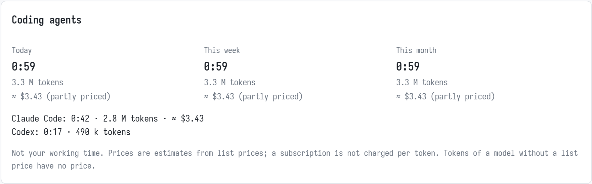

# Knorky for Claude Code

A plugin for [Claude Code](https://claude.com/claude-code) that tracks the time
you work with Claude on your Knorky account.

- **A timer above the prompt**, like the app's player: ▶ and ⏸, the task and
  its project, and the time you worked today on all tasks, in hours and
  minutes as the app shows it. A **+** adds a paused task back next
  to the timers that run, so the time is split. On a break, ▶ ends it.
- **Claude tracks by itself.** When you start a piece of work, Claude finds
  the task or creates it, starts its timer and tells you in one line. It does
  not ask first. An issue in the branch name finds the task linked to it: a
  key like `ENG-123`, or a GitHub issue number (`feat/102-…`, `gh-102`).
- **One project per repository.** Claude asks once which project a
  repository's work goes to, and remembers it.
- **Timers stop with the session.** When the session ends, the session's
  timer ends. A quiet session keeps its timer: time without prompts, such
  as testing in a browser, is work too. When another Claude Code window
  tracks the same task, its timer keeps running.
- **Breaks only when you use them.** Claude starts a break ("I'm off to
  lunch") only while breaks are switched on in the app (Settings → Tracking,
  off at first); otherwise it stops the timers.
- **Notes from your commits.** When the plugin stops a timer, the entry's
  note lists the commits made since it started.
- **Claude's own work, kept apart.** How long Claude worked and the tokens
  it used, per day and task (see [Claude's own work](#claudes-own-work)).

Contents: [What you need](#what-you-need) · [Install](#install) ·
[Sign in](#sign-in) · [Your first session](#your-first-session) ·
[The timer above the prompt](#the-timer-above-the-prompt) ·
[Commands](#commands) · [Claude's own work](#claudes-own-work) ·
[When something is wrong](#when-something-is-wrong) ·
[What it stores](#what-it-stores) · [Update or remove](#update-or-remove) ·
[Your own server](#your-own-server) · [Developing](#developing)

## What you need

- [Claude Code](https://claude.com/claude-code), in a terminal, an editor or
  the Claude desktop app.
- A Knorky account whose plan includes the API. On the hosted service that
  is the Cloud plan.
- A git repository to work in is usual, but not needed: without one, the
  project is remembered for the folder.

## Install

At the prompt of Claude Code:

```
/plugin install knorky --marketplace knorkyapp/knorky
```

Answer `y` to add the marketplace, then choose a scope (user: every
session). From a shell:

```sh
claude plugin install knorky --marketplace knorkyapp/knorky
```

In the Claude desktop app: click **+** next to the prompt box, then
**Plugins**, **Add marketplace** with `knorkyapp/knorky`, then **Add plugin**.

Start a new session afterwards: a plugin loads when a session starts.

## Sign in

The plugin brings its own connection to the Knorky server. It needs you to
sign in once:

1. Run `/mcp`.
2. Choose `plugin:knorky:knorky`, then **Authenticate**.
3. Your browser opens Knorky's sign-in. Sign in and allow the access.

Back in Claude Code, a line appears above the prompt: the timer that runs,
or, with none running:

```
⏱ not tracking · /track <task>
```

That line is the check: it shows only once the plugin reaches the server.
Run `/track` to see what runs and which project this repository uses.

If you also added Knorky as a connector on claude.ai, `/mcp` lists it too, as
`claude.ai Knorky`. Turn it off there, for Claude Code only: the plugin cannot
use a claude.ai connector, and with both on Claude sees every tool twice. It
stays on for claude.ai and your phone.

## Your first session

1. **Start a piece of work**, as you always would: "Fix the login redirect".
2. **Claude asks once for the project** of this repository, from the list of
   your projects. Answer with its name. Claude remembers it for this
   repository, in every later session.
3. **Claude finds the task or creates it, and starts its timer.** It tells
   you in one line:

   ```
   Tracking, split: Fix the login redirect
   ```

   By default the task joins the timers already running, and the time
   is split between them: two tasks that run for an hour get 30 minutes
   each. To stop the others, say so ("instead", "only this") or use
   `/track <task>`. When your words leave it unclear, Claude asks before
   stopping them. `/track default only` makes stopping the others the
   default; the line then names what it stopped.

4. **Work.** When the work moves to something clearly different, Claude
   starts that task's timer the same way. When you say the work is done,
   Claude stops the timer with a one-line note.
5. **Leave.** When you close the session, the timer ends by itself. Its
   note lists the commits you made. Going away without closing it? Press ⏸
   or say so.

Not happy with a task Claude chose? Name the right one: `/track <task>`.

## The timer above the prompt

```
[⏸ +1] Fix the login redirect · Website · today 2:40
```

| Part                     | What it means                                                                                               |
| ------------------------ | ----------------------------------------------------------------------------------------------------------- |
| ⏸                        | Pauses the task: its timer stops, the task stays here                                                       |
| ⏸ +1                     | The same, while one more timer runs: the time is split between them                                         |
| ▶                        | Starts the task again, alone                                                                                |
| +                        | Starts the task again next to the running timers: the time is split                                         |
| `Fix the login redirect` | This session's task                                                                                         |
| `Website`                | Its project                                                                                                 |
| `today 2:40`             | The time you worked today, on all tasks, as the app's today total shows it; it counts on while a timer runs |
| `+1 running`             | This task is paused; one other timer runs                                                                   |

On a break the line reads `▶ on a break · 0:15`, and ▶ ends the break. When
the server reports a problem, the line shows it: `⏱ time tracking: …`.

## Commands

| Command                 | What it does                                                                      |
| ----------------------- | --------------------------------------------------------------------------------- |
| `/track`                | What runs with each task's total, this repository's project, and a link to Knorky |
| `/track <task>`         | Tracks only this task: the other timers stop                                      |
| `/track add <task>`     | Tracks this task too: the time is split with the running ones                     |
| `/track stop`           | Stops this session's task                                                         |
| `/track default split`  | Claude adds its tasks to the running timers (the default)                         |
| `/track default only`   | Claude tracks only its task: the other timers stop                                |
| `/track project <name>` | The project this repository's time goes to                                        |

A task named with `/track` is found in the project by its title, or created.
You can also just ask Claude: "add the docs task", "track this in parallel",
"track only this", "stop the timer".

**One task, or several at once?** `/track <task>` suits one thing at a
time. `/track add <task>` suits several Claude Code windows on different
tasks at once: each window's task joins the running timers, and Knorky
shares the time between them, so the hours add up to the real time worked.

## Claude's own work

After each of Claude's turns the plugin sends the server what Claude did
in this session so far, per day and task: how long its turns took, how many
there were, the tokens they used (sub-agents' included) and the model that
wrote most. The task is the one this session tracks; with none, the
repository's project. A turn belongs to the day it ends on, in your time
zone.

The app shows it in the **Coding agents** card in Reports, and on the task's
page:



This is Claude's work, not yours: it never counts toward your tracked
time, goals, earnings or invoices. The prices are estimates from list
prices; a subscription is not charged per token. The server tool that
receives it, `record_agent_work`, is the plugin's alone: when Claude tries to
call it, the plugin refuses. When a report cannot be sent, the next one
carries the totals.

## When something is wrong

**No line above the prompt.** The plugin has not reached the server. Run
`/mcp`: `plugin:knorky:knorky` should say connected. If it asks you to
authenticate, sign in (see [Sign in](#sign-in)). If it does not appear at
all, check that the plugin is installed and enabled (`/plugin`), and start a
new session.

**`/track` says "No time-tracking server is connected."** The same: sign in
through `/mcp`.

**The line says `⏱ time tracking: …`.** The server refused a call, and the
line shows why. When it is about the plan, your account's plan does not
include the API.

**Claude sees every tool twice.** The claude.ai connector and the plugin's
server are both on. Turn off `claude.ai Knorky` in `/mcp`.

**The timer kept running after I closed the session.** Another Claude Code
window tracks the same task, so it keeps its timer. Or the server could not
be reached when the session ended: stop it in the app, or ask Claude to
stop it.

**The time goes to the wrong project.** `/track project <name>` changes it
for this repository.

**In auto mode, the plugin's calls are refused.** Update the plugin: since
0.3.3 its own calls to the server pass auto mode.

## What it stores

On your computer, in Claude Code's plugin storage: the project chosen for
each repository (keyed by the repository's `origin` address); and each session's agent work per day and task (time,
turns, token counts and the models' names, never what was said), kept for
a week so a report that could not be sent goes later. In `~/.claude/plugin-sessions/knorky/`, one
small file per session naming the task it tracks, so two windows on one
task know of each other. Everything else stays on the server, which the
plugin reaches only through the server's own tools.

## Update or remove

```sh
claude plugin update knorky@knorky     # the latest version, from the next session
claude plugin uninstall knorky@knorky  # removes it
```

At the prompt, `/plugin` does the same from a menu. Removing the plugin
leaves your tasks and time on the server.

## Your own server

The plugin connects to the hosted server, `https://api.knorky.com/mcp`. For
your own server, add it to Claude Code yourself, with the Client ID from
Knorky's settings (Account → AI & API → Connect AI assistants):

```sh
claude mcp add --transport http --client-id <Client ID> --callback-port 33418 time <MCP address>
```

Then turn off `plugin:knorky:knorky` in `/mcp`. The plugin finds a server by its tools,
whatever its name.

## Developing

```sh
claude --plugin-dir claude-plugin   # a session with this folder's plugin
claude plugin validate claude-plugin
claude plugin test claude-plugin
```

The hooks are in `hooks/register.tsx`, the state they keep in
`types/index.d.ts`, the tests in `tests/`. Once a session has loaded the
plugin, `tsc -p claude-plugin` type-checks it.
